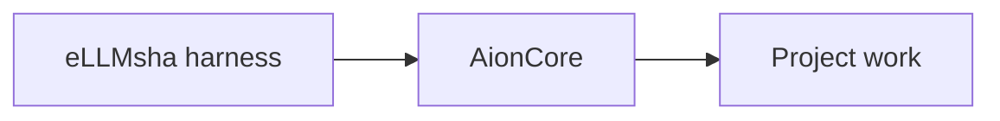

<!-- ELLMSHA FORK INTRO -->
# AionCore — eLLMsha integration fork

**Rust application backend: sessions, tools, projects, chat history and plugin routing.**

| Provenance | Value |
| --- | --- |
| Original project | [AionCore](https://github.com/iOfficeAI/AionCore) |
| Upstream baseline | `v0.1.58` |
| Baseline revision | `134daddccf129d1642e08e709522f835fb734572` |
| Harness patch label | 1 |

## Why this fork exists

Project memory integration, plugin compatibility, browser/history capabilities and agent lifecycle handling.

## Build and integration

Requires the sibling patched `aionrs` checkout. Build with `cargo build --locked -p aionui-app --bin aioncore`.

The parent repository's installer and integration checks are authoritative for the bundled product. A passing upstream test suite alone does not prove eLLMsha integration acceptance. This local documentation update does not publish a release or make unpublished revisions available remotely.

## Contributing

Keep changes focused, preserve upstream licenses and notices, and separate an upstream version update from a harness patch. Record both in the parent application's About provenance. Do not commit credentials, user profiles or commercial project contents. Validate behavior on the platform being changed.

## License and credits

See [LICENSE](LICENSE). Original authors and their license terms remain unchanged. **Moroz Inc.** maintains the eLLMsha integration.

---

## Upstream documentation

<!-- END ELLMSHA FORK INTRO -->

For implementation details, see [Architecture](ARCHITECTURE.md).
